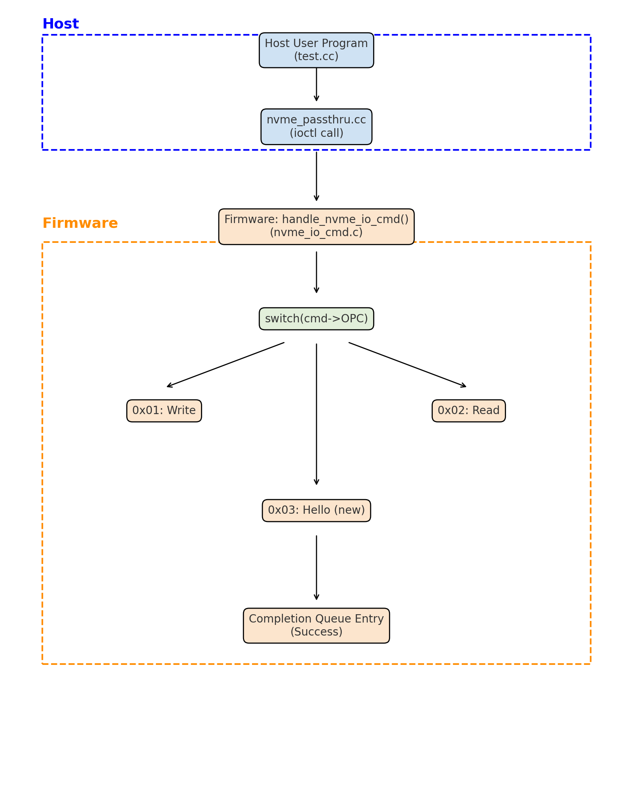

# 01 · NVMe passthru와 커스텀 NVMe 명령

호스트 유저 프로그램에서 NVMe 명령을 직접 만들어 보내고, SSD 펌웨어에는 표준에 없는 새 명령을 추가했다.

## 목표

- 블록 레이어를 거치지 않고 `ioctl(NVME_IOCTL_IO_CMD)`로 NVMe READ/WRITE 명령을 직접 구성해 이미지 파일을 SSD에 쓰고 다시 읽는다.
- 펌웨어 HIL(Host Interface Layer)에 새 opcode를 등록해, 호스트 명령 하나가 펌웨어까지 전달되어 처리되는 전체 경로를 만든다.

## 분석: 펌웨어가 읽는 필드부터 역으로 추적

호스트에서 무엇을 채워야 하는지는 펌웨어 `handle_nvme_io_read/write()`가 명령에서 무엇을 꺼내 쓰는지를 보고 정했다.

| `nvme_passthru_cmd` 필드 | 펌웨어에서 읽는 위치 | 의미 |
|---|---|---|
| `opcode` | `nvmeIOCmd->OPC` | 0x01 WRITE, 0x02 READ, 0x03 HELLO(새 명령) |
| `cdw10`, `cdw11` | `dword[10]`, `dword[11]` | 시작 LBA 하위·상위 32bit |
| `cdw12[15:0]` | `IO_READ_COMMAND_DW12.NLB` | 블록 수. **0-based**라 펌웨어가 `nlb + 1`로 계산 |
| `addr`, `data_len` | (커널 드라이버가 PRP로 변환) | 데이터 버퍼 |

여기서 확인한 점:
- NLB를 1-based로 넣으면 펌웨어는 한 블록을 더 DMA하려고 기다리다 타임아웃이 난다.
- 펌웨어는 `data_len`이 아니라 NLB만 보고 4KB 단위로 DMA를 준비한다. 그래서 마지막 조각이 4KB보다 작으면 0으로 채운 4KB 버퍼로 보내야 한다.

## 구현

**호스트** (`host/`)
- `nvme_passthru()`: 모든 I/O가 거치는 공통 함수. 위 표의 필드를 채워 `ioctl`로 커널 NVMe 드라이버에 넘긴다.
- `ImageWrite()` / `ImageRead()`: 이미지를 4KB(1 LBA) 단위로 잘라 LBA 0부터 순서대로 전송하고, 읽을 때는 같은 위치를 같은 단위로 읽어 원래 크기만큼 복원한다.
- `Hello()`: 데이터 없이 opcode만 담은 HELLO 명령을 보낸다.

**펌웨어** (`firmware/nvme/`)
- `nvme.h`: `IO_NVM_HELLO = 0x03` 등록. 호스트 쪽 opcode와 값이 같아야 한다.
- `nvme_io_cmd.c`: `handle_nvme_io_cmd()`의 opcode 분기에 HELLO case를 추가해 UART로 자기소개를 출력한다. 데이터 전송이 없는 명령이라 DMA 완료를 기다리지 않고 바로 성공 completion을 보낸다(FLUSH와 같은 방식). 이걸 보내지 않으면 호스트 `ioctl`이 반환되지 않는다.

| 파일 | 변경 |
|---|---|
| `host/nvme_passthru.h` | HELLO opcode, `nvme_passthru()` 인자 정의 |
| `host/nvme_passthru.cc` | `nvme_passthru`, `ImageWrite`, `ImageRead`, `Hello` 구현 |
| `host/test.cc` | 장치 경로, Task 3 모드 설정 |
| `firmware/nvme/nvme.h` | `IO_NVM_HELLO` 정의 |
| `firmware/nvme/nvme_io_cmd.c` | HELLO 처리 분기 |

전체 diff: [`changes.patch`](changes.patch)

## 결과

- 3.9MB PNG 이미지를 write 후 read한 결과가 원본과 **바이트 단위로 일치**
- HELLO 명령 발행 시 UART에 자기소개 출력, 호스트 `ioctl` 정상 반환

## 한계

- 명령 하나에 1 LBA(4KB)씩만 보낸다. 3.9MB 이미지면 약 960번 `ioctl`을 호출한다. 장치의 최대 전송 크기(MDTS) 안에서 여러 LBA를 한 번에 보내면 호출 횟수를 크게 줄일 수 있다.
