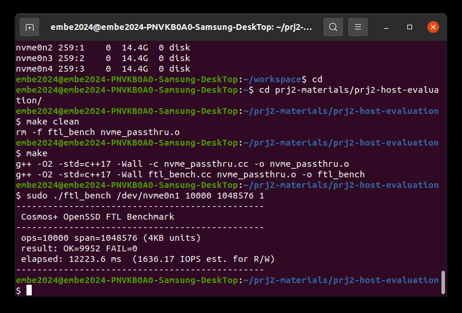
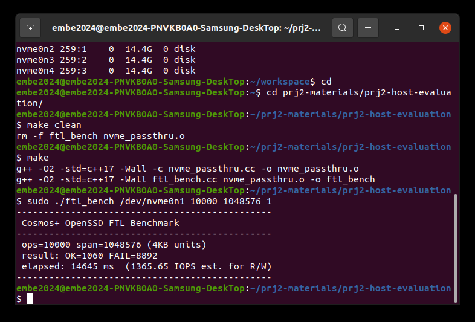
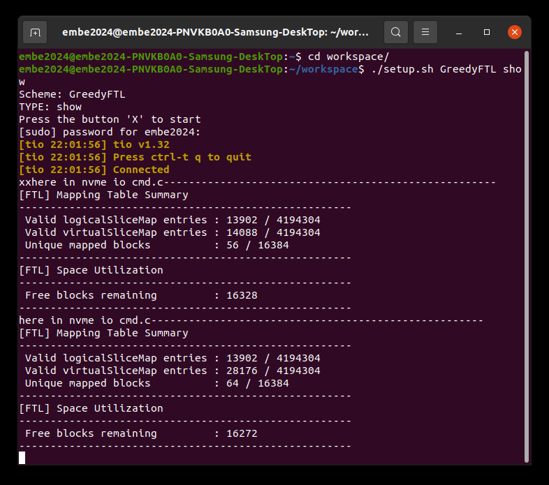
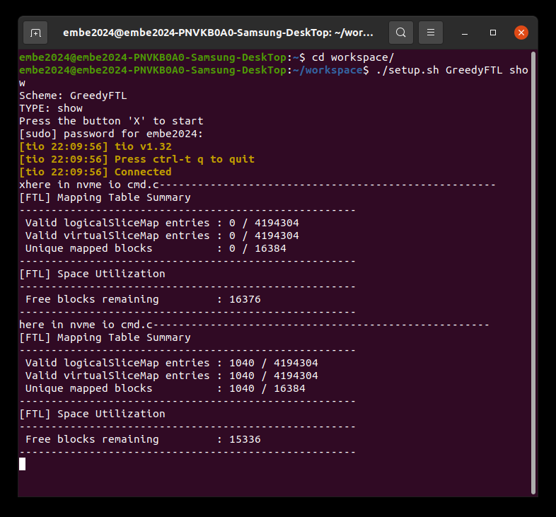

# 02 · Page-level FTL을 Block-level FTL로

GreedyFTL 펌웨어의 주소 변환을 page 단위 매핑에서 block 단위 매핑으로 바꾸고, 두 방식의 트레이드오프를 측정했다.

## 목표

- 호스트 I/O가 펌웨어 안에서 NAND 주소가 되기까지의 경로를 코드 수준에서 추적한다.
- 같은 논리 블록(LBN)에 속한 데이터는 항상 같은 물리 블록에 들어가도록 주소 변환을 바꾼다.

## 분석: 기존 I/O 경로

```
NVMe 명령 (LBA, 4KB 단위)
  → ReqTransNvmeToSlice      LBA를 slice 단위 요청으로 분할
  → ReqTransSliceToLowLevel  데이터 버퍼 hit/miss 처리, 필요하면 read-modify-write
  → AddrTransWrite / AddrTransRead   LSA ↔ VSA 주소 변환  ← 이번 수정 지점
  → NAND 요청
```

- **Slice**: FTL의 매핑 단위. 16KB = LBA 4개 = NAND page 1개.
- 기존 page-level은 `logicalSliceMap[LSA]`에 slice마다 물리 위치(VSA)를 따로 저장한다. write할 때마다 die를 돌아가며 다음 빈 page를 받으므로 위치가 자유롭지만, 매핑 테이블이 slice 수만큼 커진다.

## 설계

| | Page-level (기존) | Block-level (구현) |
|---|---|---|
| 매핑 단위 | slice(page) | 블록 (256 slice) |
| 테이블 인덱스 | LSA | LBN = LSA / 256 |
| 저장 값 | slice의 VSA | 블록의 page 0 VSA |
| 블록 안 위치 | 테이블에 저장 | 저장하지 않음 |

**Write** ([`address_translation.c`](firmware/address_translation.c) `AddrTransWrite`)
- LBN의 첫 write면 free block을 하나 받아 그 블록을 LBN에 배정한다.
- 이미 배정된 블록이면 그 블록의 `currentPage`(다음 빈 page)에 이어 쓴다. NAND는 블록 안에서 page 0부터 순서대로만 program할 수 있어서 호스트가 준 offset 위치에 바로 쓸 수 없다.
- 블록 256 page를 다 쓰면 새 블록으로 교체한다.
- 기존 `InvalidateOldVsa`는 slice 단위 매핑을 전제로 해서 끄고, GC는 구현하지 않았다.

**Read** (`AddrTransRead`)
- LBN으로 블록을 찾은 뒤 블록 안 page 위치를 정해야 하는데, 이 위치를 테이블에 두지 않는 것이 block-level의 핵심이다. 두 버전을 만들었다.
  - **v1** [`v1/`](firmware/v1/address_translation.c): 항상 블록의 page 0을 읽는다.
  - **v2 (개선)** [`firmware/address_translation.c`](firmware/address_translation.c): `LSA % 256`을 page 위치로 쓴다. 순차 write에서는 쓴 순서와 offset이 같아 정확히 맞고, 랜덤 write에서는 어긋난다.

전체 diff (v2 기준): [`changes.patch`](changes.patch)

## 결과

벤치마크: 4KB 랜덤 write 10,000회 → 캐시 비우기용 write → 전체 read 검증 (span 1,048,576 LBA)

| | Page-level | Block-level (v1) |
|---|---|---|
| 호스트 결과 | OK 9,952 / FAIL 0 | OK 1,060 / FAIL 8,892 |
| 매핑 엔트리 | 13,902 | **1,040** (약 13배 감소) |
| 사용 중인 블록 | 56 | **1,040** (약 19배 증가) |

| Page-level | Block-level (v1) |
|---|---|
|  |  |
|  |  |

Page-level 장치 화면은 보드를 다시 올리지 않은 채 같은 시드로 두 번 실행한 화면이라, 첫 번째 요약이 1회 실행 결과다.

**해석**
- Block-level은 LBN마다 엔트리가 하나라 매핑 엔트리 수 = 블록 수(1,040)가 된다. 매핑 테이블은 크게 줄었다.
- 대신 랜덤 write는 1,024개 LBN에 평균 10번씩 흩어지므로, LBN마다 256 page짜리 블록을 하나씩 잡고 10 page 정도만 쓴다. 블록 사용 효율이 매우 낮다.
- v1의 FAIL 비율이 약 9:1인 이유: LBN당 평균 10번 write 중 page 0에 들어간 첫 번째만 맞게 읽히기 때문이다.

## 한계와 보완 방향

- **정합성**: 블록 안 위치를 저장하지 않는 한 랜덤 write의 정합성을 맞출 수 없다. LBN마다 page offset 테이블을 두면 해결되지만, 추가 메모리가 필요해 block-level의 장점이 줄어든다.
- **GC 없음**: 블록을 교체할 때 이전 블록을 회수하지 않는다.
- **Hybrid FTL**: 대부분의 데이터는 block 단위(data block)로, 자주 갱신되는 데이터는 page 단위(log block)로 관리하면 메모리와 랜덤 write 성능을 함께 잡을 수 있다 (FAST FTL, Lee et al., ACM TECS 2007).
