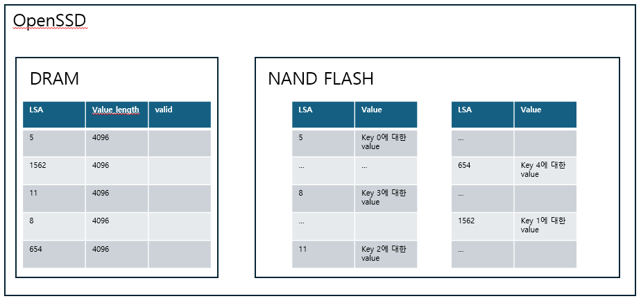
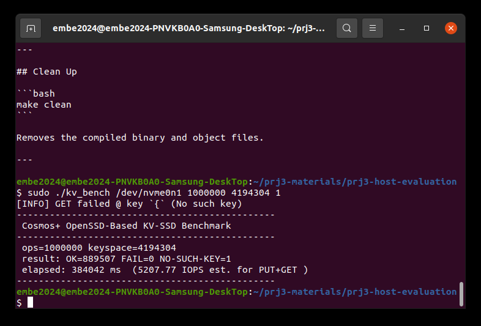

# 03 · Key-Value SSD

블록 주소(LBA) 대신 key로 데이터를 읽고 쓰는 Key-Value 인터페이스를 SSD 펌웨어 안에 구현했다.

## 목표

- 호스트가 보내는 KV-PUT / KV-GET NVMe 명령을 펌웨어가 해석해 처리한다.
- key → 데이터 위치를 찾는 인덱스와, value를 NAND에 저장·갱신하는 방식을 설계한다.

## 블록 명령과 KV 명령의 차이

| | 블록 I/O | KV I/O |
|---|---|---|
| opcode | 0x01 WRITE / 0x02 READ | 0xA0 KV-PUT / 0xA1 KV-GET (vendor-specific 영역) |
| `dword[10]` | 시작 LBA | **key** |
| 위치 결정 | 호스트(파일시스템)가 LBA를 정함 | **SSD가 정하고 인덱스로 관리** |

호스트 쪽에서는 파일시스템과 블록 레이어를 거치지 않고 key로 바로 SSD에 요청할 수 있다. 주소 관리 부담이 SSD 안으로 옮겨진다.

## 설계

**인덱스: direct-mapped 배열** ([`kv_store.h`](firmware/kv_store.h))

```c
kv_index[key] = { lsa, value_len, valid }   // key 4,194,304개 전체를 미리 할당
```

- 벤치마크의 key는 0 ~ 4M-1 범위의 4바이트 정수다. 그래서 key를 그대로 배열 인덱스로 쓰면 해시 충돌 처리나 트리 탐색 없이 O(1)로 찾는다.
- 엔트리 12B × 4M ≈ 48MB를 FTL 관리 영역 뒤의 예약 DRAM에 둔다.
- 트레이드오프: key가 듬성듬성하면 공간 낭비가 크고, 가변 길이 문자열 key라면 해시나 LSM-tree가 필요하다.



**Value 저장: append-only log** ([`kv_store.c`](firmware/kv_store.c), [`nvme_io_cmd.c`](firmware/nvme/nvme_io_cmd.c))
- PUT은 value를 log의 끝(`kv_current_lsa`)에 쓰고 인덱스에 그 위치를 기록한다.
- 같은 key를 다시 PUT하면 새 위치에 쓰고 인덱스만 바꾼다. 이전 value는 더 이상 참조되지 않는다.
- 실제 NAND 쓰기는 기존 블록 write 경로(`ReqTransNvmeToSlice`)에 그대로 맡긴다. FTL은 KV 명령인지 모르고 일반 write로 처리하므로 FTL을 고치지 않아도 된다.

**GET의 completion 처리** ([`request_transform.c`](firmware/request_transform.c), [`request_allocation.c`](firmware/request_allocation.c))
- 호스트 `kv_bench`는 GET completion의 `result` 필드를 value 길이로 읽는데, 하드웨어 auto completion은 `result`를 항상 0으로 채운다.
- 그래서 KV-GET일 때만 read DMA의 auto completion을 끄고, DMA가 끝난 시점에 `result = 4096`을 담아 직접 completion을 보낸다. 어떤 명령인지는 명령 SRAM에 남은 원래 opcode로 구분한다.
- 없는 key는 데이터 전송 없이 `SC_NO_SUCH_KEY`로 바로 완료한다. completion의 상태 필드는 bit 0이 Phase Tag 자리라 상태 코드를 1비트 밀어서 넣어야 했다.

| 파일 | 변경 |
|---|---|
| `kv_store.h`, `kv_store.c` | 새 파일: 인덱스 정의와 초기화 |
| `nvme/nvme.h` | KV opcode, `SC_NO_SUCH_KEY` 정의 |
| `nvme/nvme_io_cmd.c` | KV-PUT / KV-GET 핸들러와 분기 |
| `request_transform.c` | KV-GET read DMA의 auto completion 끄기 |
| `request_allocation.c` | KV-GET DMA 완료 시 value 길이를 담아 completion 전송 |
| `ftl_config.c` | 부팅 시 인덱스 초기화 호출 |

전체 diff: [`changes.patch`](changes.patch)

## 결과

| ops | keyspace | 결과 | 성능 |
|---|---|---|---|
| 1,000,000 | 4,194,304 | OK 889,507 / **FAIL 0** / NO-SUCH-KEY 1 | 5,207.77 IOPS |
| 100,000 | 524,288 | OK 91,121 / **FAIL 0** / NO-SUCH-KEY 1 | 5,400.97 IOPS |



NO-SUCH-KEY 1은 벤치마크가 일부러 없는 key를 조회해 "없음" 응답을 확인하는 항목이다.

## 한계

- value 크기를 4KB로 고정했다.
- append-only라 덮어쓴 이전 value 공간을 회수하지 않는다(GC 없음). log가 계속 앞으로만 간다.
- 인덱스가 DRAM에만 있어 전원이 꺼지면 사라진다.
