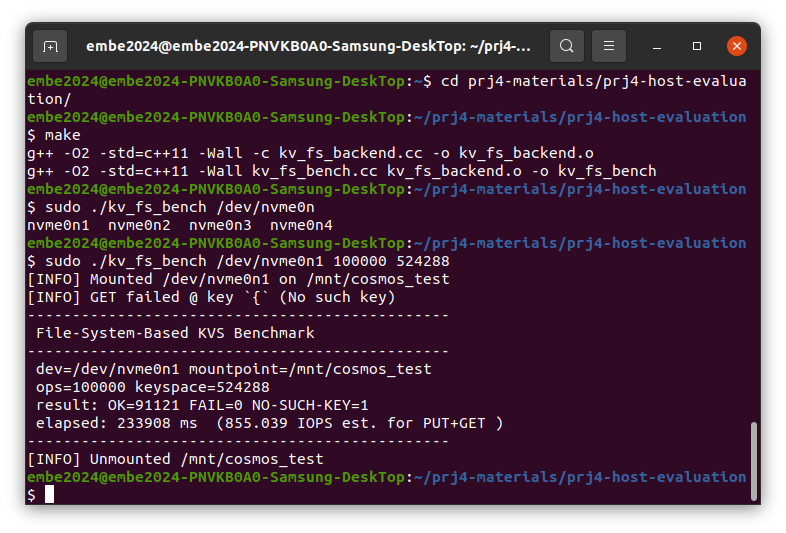
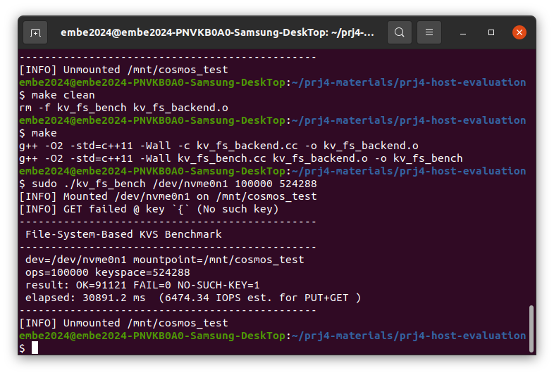
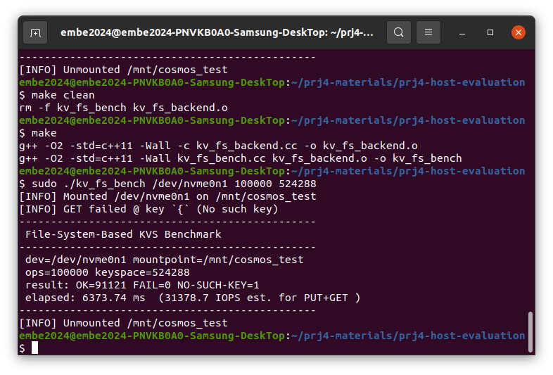
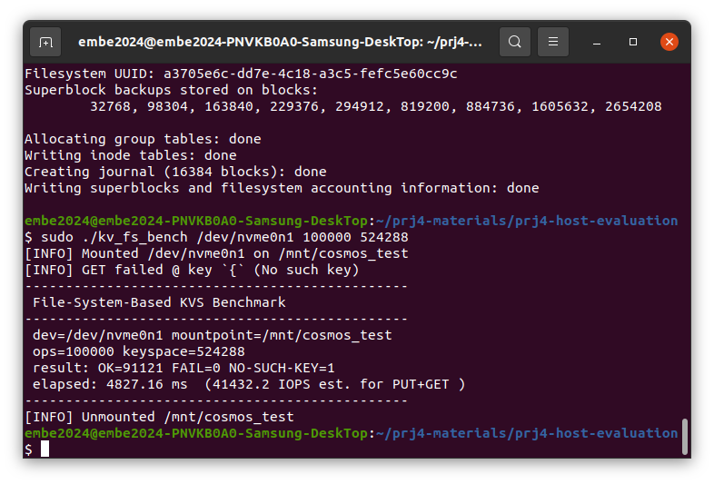
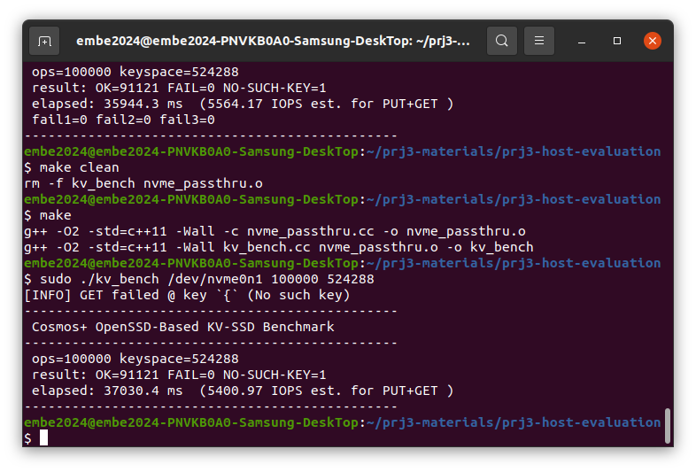

# 04 · 커널 수정으로 ext4 올리기 + 파일 기반 KVS와 KV-SSD 비교

수정하지 않은 Linux 커널에서는 Cosmos+ OpenSSD에 `mkfs.ext4`가 실패한다. 펌웨어는 건드리지 않고 **커널만 고쳐서** 원인을 해결한 뒤, ext4 위의 파일 기반 Key-Value Store와 03에서 만든 KV-SSD의 성능을 비교했다.

## Task 1 · mkfs.ext4 실패

### 원인

`mkfs.ext4`는 파일시스템을 만들면서 블록을 초기화하기 위해 일반 READ/WRITE가 아닌 NVMe 명령을 쓴다.

| 명령 | opcode | 용도 |
|---|---|---|
| Write Zeroes | 0x08 | 데이터를 보내지 않고 "이 범위를 0으로 채워라"만 지시 (inode table 등 초기화) |
| Dataset Management (discard/TRIM) | 0x09 | 사용하지 않는 블록 해제 |

Cosmos+ 펌웨어는 NVMe 최소 명령(FLUSH, WRITE, READ)만 구현돼 있다. 그 외 opcode가 들어오면 `handle_nvme_io_cmd()`의 `default` 분기에 있는 `ASSERT(0)`에서 무한 루프에 빠진다. 장치가 응답하지 않으니 호스트 쪽에서는 타임아웃과 abort로 이어진다.

```c
default:
    xil_printf("Not Support IO Command OPC: %X\r\n", opc);
    ASSERT(0);   // 실패 시 while(1)
```

### 해결 방향

| 방법 | 장단점 |
|---|---|
| 펌웨어에 두 명령 구현 | 가장 근본적이지만 이번 과제 조건(펌웨어 수정 금지)에 맞지 않음 |
| `mkfs.ext4 -E nodiscard` 등 옵션으로 우회 | 사용자가 매번 옵션을 줘야 하고, mkfs 외 다른 프로그램은 막지 못함 |
| **커널 NVMe 드라이버에 장치 quirk 추가** | 이 장치에만 적용되고, 커널을 한 번 올리면 모든 프로그램에 적용됨 |

Linux에는 표준을 완전히 구현하지 못한 장치를 위해 장치별 예외 플래그(quirk)를 두는 방식이 이미 있다. 이 방식으로 두 가지를 구현했다.

### 방식 A · Write Zeroes 우회

[`approach-a-write-zeroes.patch`](approach-a-write-zeroes.patch): `pci.c`, `blk_types.h`, `blk-mq.c`

1. **장치 등록** (`pci.c` `nvme_id_table`): Cosmos+의 PCI ID(Xilinx `10ee:7028`)에 커널에 이미 있는 `NVME_QUIRK_DISABLE_WRITE_ZEROES`를 붙인다. 이 quirk가 켜지면 드라이버가 Write Zeroes 크기 한도를 0으로 두고, 블록 레이어는 0으로 채운 일반 write로 대신 초기화한다.
2. **요청 차단** (`pci.c` `nvme_queue_rq`): 그래도 Write Zeroes 요청이 내려오면 장치로 보내지 않고 새 상태 코드 `BLK_STS_BYPASS`로 돌려보낸다.
3. **상태 코드 추가** (`blk_types.h`): `BLK_STS_BYPASS` 정의.
4. **블록 레이어 처리** (`blk-mq.c`): `BLK_STS_BYPASS`를 받은 요청을 바로 종료시킨다.

### 방식 B · discard 비활성화

[`approach-b-discard.patch`](approach-b-discard.patch): `core.c`, `nvme.h`

1. **새 quirk** (`nvme.h`): `NVME_QUIRK_NO_DISCARD` 추가.
2. **장치 식별** (`core.c`): Identify Controller 응답의 모델명이 `COSMOS+`로 시작하면 quirk를 켠다.
3. **discard 한도 0** (`core.c` `nvme_init_non_mdts_limits`): quirk가 있으면 discard 한도를 0으로 둔다. 한도가 0이면 블록 레이어가 discard 요청을 아예 만들지 않는다.
4. **추가 조회 생략**: 함수 뒤쪽의 추가 Identify 조회가 discard 한도를 다시 채우지 않도록 여기서 끝낸다.

### 두 방식 비교

| | A · Write Zeroes 우회 | B · discard 비활성화 |
|---|---|---|
| 막는 명령 | Write Zeroes (0x08) | Dataset Management (0x09) |
| 장치 식별 | PCI Vendor/Device ID | Identify 모델명 문자열 |
| 수정 범위 | NVMe 드라이버 + 블록 레이어 공통 코드 | NVMe 드라이버만 |

- A는 PCI ID로 식별해서, 리눅스가 다른 장치 quirk를 등록하는 표준 방식과 같다. 다만 블록 레이어 공통 코드(`blk_types.h`, `blk-mq.c`)까지 고쳐야 했다.
- B는 NVMe 드라이버 안에서 끝나 수정 범위가 작다. 대신 모델명 문자열에 의존한다.

두 patch 모두 Linux 5.15.190 원본에 적용됨을 확인했다 (`patch -p1 --dry-run`).

## Task 2 · 파일 기반 KVS vs KV-SSD

같은 조건(100,000 ops, keyspace 524,288)에서 측정했다. 파일 기반 KVS는 fsync를 몇 번의 PUT마다 부를지(`KV_FSYNC_PERIOD`)를 바꿔가며 돌렸다.

| 구성 | IOPS | 매 요청이 바로 영구 저장되나 |
|---|---:|---|
| 파일 KVS, fsync 주기 1 | 855 | O |
| 파일 KVS, fsync 주기 10 | 6,474 | X |
| 파일 KVS, fsync 주기 100 | 31,378 | X |
| 파일 KVS, fsync 주기 1000 | 41,432 | X |
| **KV-SSD (03)** | **5,401** | **O** |

| fsync 1 | fsync 10 | fsync 100 | fsync 1000 | KV-SSD |
|---|---|---|---|---|
|  |  |  |  |  |

**해석**
- **fsync 주기**: 주기를 1에서 1000으로 늘리면 약 48배 빨라진다. fsync는 페이지 캐시의 데이터를 장치에 강제로 내리는 호출이라 매번 실제 장치 I/O가 일어난다. 주기가 길수록 여러 요청을 메모리에서 모아 한 번에 내리므로 빠르지만, 그 사이 전원이 꺼지면 데이터를 잃는다.
- **같은 내구성끼리 비교하면 KV-SSD가 약 6.3배 빠르다.** KV-SSD는 PUT마다 바로 장치에 기록하므로 fsync 주기 1과 내구성이 같다. 파일 KVS는 요청마다 ext4 → 블록 레이어 → NVMe 드라이버를 거치고 fsync로 동기화 비용까지 내지만, KV-SSD는 KV 명령이 드라이버에서 바로 장치로 간다.
- **fsync 주기 10 이상에서는 파일 KVS가 더 빠르다.** 호스트 페이지 캐시에 모아서 내리는 효과 때문이다. KV-SSD 쪽은 모든 요청을 장치 안 ARM 코어의 펌웨어가 하나씩 처리하는 것이 병목이 된다.
- 결론: KV-SSD의 가치는 **매 요청을 영구 저장하는 조건에서** 호스트 소프트웨어 스택을 건너뛰어 성능을 확보하는 데 있다.
