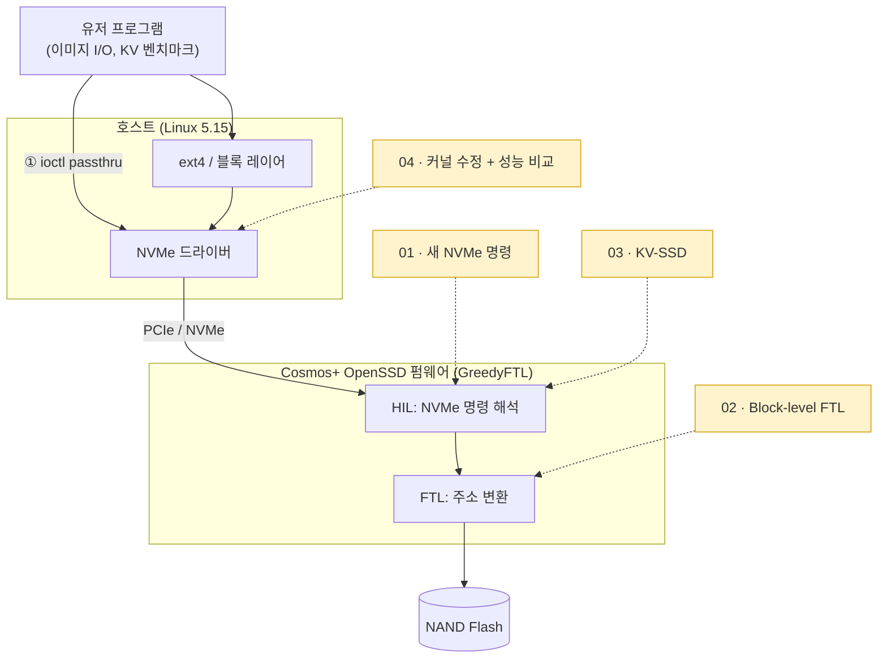

# Cosmos+ OpenSSD: Host-to-NAND Storage Stack

Cosmos+ OpenSSD를 기반으로 호스트 프로그램, Linux 커널, NVMe 인터페이스, SSD 펌웨어를 직접 수정한 4단계 프로젝트입니다.
커스텀 명령, Block-level FTL, KV-SSD 구현과 성능 비교를 통해 호스트의 요청이 NAND 접근으로 이어지는 경로를 살펴보고, 각 계층의 설계가 시스템의 동작과 성능에 미치는 영향을 분석했습니다.

> 서강대학교 임베디드시스템소프트웨어(CSE4116, 2025 가을) Cosmos+ OpenSSD 실습

## 4단계가 건드린 층



| 단계 | 건드린 층 | 한 일 | 결과 |
|---|---|---|---|
| [01 · NVMe 커스텀 명령](01-nvme-custom-command/) | 호스트 + 펌웨어 HIL | ioctl passthru로 NVMe read/write를 직접 구성하고, 펌웨어에 새 명령(HELLO) 추가 | 3.9MB 이미지 write → read 바이트 단위 일치 |
| [02 · Block-level FTL](02-block-level-ftl/) | 펌웨어 FTL | page 단위 주소 매핑을 block 단위로 변경 | 매핑 엔트리 13,902 → 1,040 (약 13배 감소), 대신 사용 블록 56 → 1,040 (약 19배 증가) |
| [03 · KV-SSD](03-kv-ssd/) | 펌웨어 HIL + 요청 처리 | SSD 안에 Key-Value 인터페이스(PUT/GET)와 인덱스 구현 | 100만 회 PUT/GET, FAIL 0 |
| [04 · 커널 수정 + KVS 비교](04-kernel-ext4-kvs/) | Linux NVMe 드라이버 / 블록 레이어 | mkfs.ext4가 실패하는 원인을 찾아 커널 수정 (두 가지 방식), 파일 기반 KVS와 KV-SSD 성능 비교 | 같은 내구성(매 요청 sync) 조건에서 KV-SSD가 약 6.3배 빠름 |

## 폴더 구성

각 단계 폴더에는 다음이 들어 있습니다.

- `README.md`: 문제, 원인 분석, 설계, 결과, 한계
- 수정한 소스 파일만 (펌웨어·커널 전체는 넣지 않음). 바꾼 곳마다 `// [prjN]` 주석으로 무엇을 왜 바꿨는지 표시
- `changes.patch`: 원본 대비 diff. GitHub에서 바로 변경 부분만 볼 수 있음

```
01-nvme-custom-command/   host/ (C++ 유저 프로그램), firmware/nvme/
02-block-level-ftl/       firmware/address_translation.c (+ v1/)
03-kv-ssd/                firmware/ (kv_store.*, nvme/, request_*.c, ftl_config.c)
04-kernel-ext4-kvs/       approach-a-write-zeroes.patch, approach-b-discard.patch, results/
```

## 환경

- 보드: Cosmos+ OpenSSD (Xilinx Zynq-7000, ARM Cortex-A9 + FPGA NVMe 컨트롤러)
- 펌웨어: GreedyFTL (Hanyang Univ. ENC Lab), Xilinx SDK 2019.1
- 호스트: Ubuntu, Linux 5.15.190, C++17
- 펌웨어 파일은 `GreedyFTL/cosmos_app/src/`의 같은 경로 파일을 교체하는 방식입니다. 펌웨어는 단계가 누적되므로 03의 `nvme_io_cmd.c`에는 01의 HELLO 명령도 함께 들어 있습니다.
